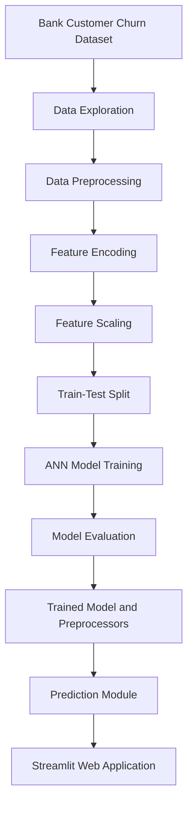
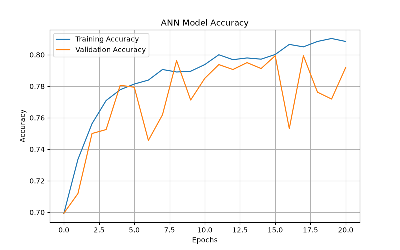
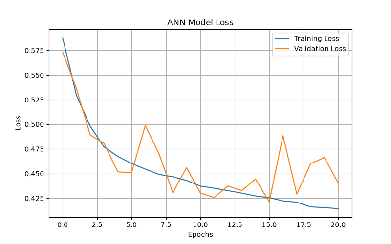
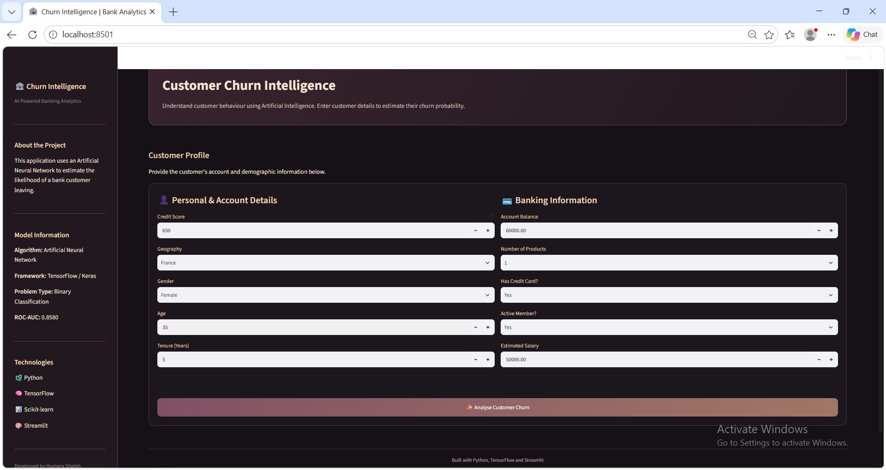
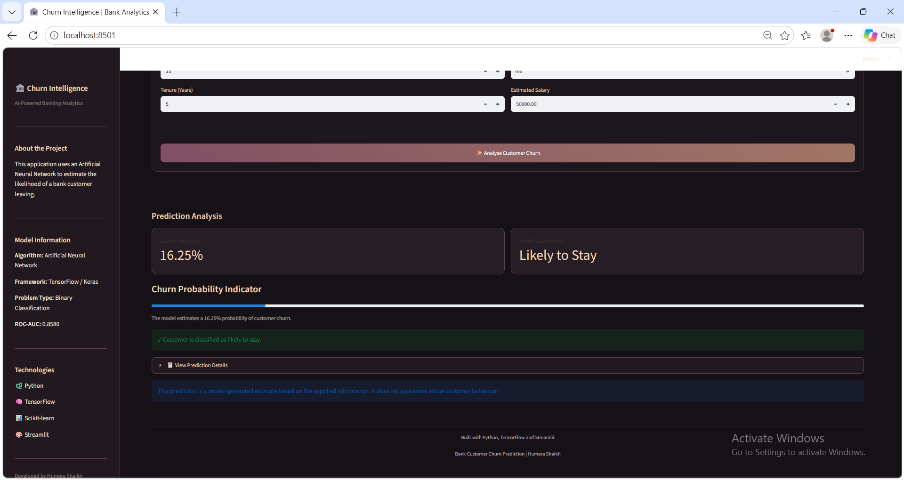

# 🏦 Bank Customer Churn Prediction using Artificial Neural Network (ANN)

An end-to-end deep learning project that uses an Artificial Neural Network (ANN) to predict the likelihood of bank customer churn, with an interactive Streamlit application for generating predictions.

<p align="center">
  
  
  
  
  
</p>

---

## 📌 Project Overview

Customer churn is an important challenge in the banking industry. Identifying customers who may leave a bank can help businesses understand customer behaviour and develop better customer retention strategies.

This project uses an **Artificial Neural Network (ANN)** built with TensorFlow and Keras to estimate whether a bank customer is likely to leave or continue using banking services.

The project covers the complete machine learning workflow:

- Data exploration and analysis
- Data preprocessing and feature engineering
- ANN model development and training
- Model evaluation
- Customer churn prediction
- Interactive Streamlit web application

## 🎯 Problem Statement

The objective is to develop a binary classification model that predicts customer churn based on information such as:

- Credit Score
- Geography
- Gender
- Age
- Account Tenure
- Account Balance
- Number of Bank Products
- Credit Card Ownership
- Active Membership
- Estimated Salary

**Target Variable:**

| Value | Meaning |
|---|---|
| 0 | Customer stays |
| 1 | Customer leaves |

## 🛠️ Technologies Used

| Technology | Purpose |
|---|---|
| Python | Programming language |
| TensorFlow | Deep learning framework |
| Keras | ANN model development |
| Pandas | Data manipulation |
| NumPy | Numerical operations |
| Scikit-learn | Preprocessing and evaluation |
| Matplotlib | Data visualization |
| Joblib | Saving training history and utilities |
| Streamlit | Interactive web application |

## 📂 Dataset

**Dataset:** Bank Customer Churn Modelling

- Total Records: 10,000
- Original Columns: 14
- Target Column: `Exited`
- Problem Type: Binary Classification

**Dataset Source:**

[Bank Customer Churn Modelling Dataset](https://github.com/pdt0208/Banking-Churn-Modelling/blob/main/Churn_Modelling.csv)

The dataset contains customer demographic and banking information used to train the ANN model.

## 🔄 Project Workflow



## 🧹 Data Preprocessing

The following preprocessing steps were performed:

1. Removed unnecessary columns:
   - `RowNumber`
   - `CustomerId`
   - `Surname`

2. Applied Label Encoding to the `Gender` column.

3. Applied One-Hot Encoding to the `Geography` column.

4. Divided the dataset into training and testing sets using an 80:20 split.

5. Applied StandardScaler to standardize numerical features.

6. Saved the fitted encoders and scaler for use during prediction.

**Preprocessing Summary:**

| Description | Result |
|---|---:|
| Training Samples | 8,000 |
| Testing Samples | 2,000 |
| Input Features | 12 |
| Training Split | 80% |
| Testing Split | 20% |

The preprocessing objects were saved so that new customer information receives the same transformations as the training data.

## 🧠 ANN Model Architecture

The Artificial Neural Network was developed using TensorFlow and Keras.

| Layer | Neurons | Activation |
|---|---:|---|
| Input Layer | 12 features | - |
| Hidden Layer 1 | 64 | ReLU |
| Hidden Layer 2 | 32 | ReLU |
| Output Layer | 1 | Sigmoid |

### Model Configuration

| Parameter | Value |
|---|---|
| Optimizer | Adam |
| Loss Function | Binary Crossentropy |
| Evaluation Metric | Accuracy |
| Batch Size | 32 |
| Maximum Epochs | 50 |
| Early Stopping | Enabled |
| Class Weighting | Applied |

**Class weighting** was used to address the imbalance between customers who stayed and customers who left.

Early Stopping was used to monitor validation loss and restore the best model weights.

## 📊 Model Evaluation

The model was evaluated using the test dataset containing 2,000 customer records.

### Evaluation Results

| Metric | Score |
|---|---:|
| Accuracy | 79.95% |
| ROC-AUC | 0.8580 |
| Churn Precision | 0.50 |
| Churn Recall | 0.75 |
| Churn F1-Score | 0.60 |

### Confusion Matrix

| Actual / Predicted | Predicted Stay | Predicted Churn |
|---|---:|---:|
| Actual Stay | 1292 | 301 |
| Actual Churn | 100 | 307 |

### Evaluation Insights

- The model achieved approximately **79.95% test accuracy**.
- The ROC-AUC score of **0.8580** indicates its ability to distinguish between the two classes.
- Churn recall of **0.75** means the model identified 75% of actual churn cases in the test dataset.
- Churn precision of **0.50** indicates that half of the customers predicted to leave actually left in the test dataset.
- Class weighting improved churn detection but also increased false-positive predictions.

### Training Visualizations

The following graphs show the model's training and validation performance.

#### Model Accuracy



#### Model Loss



These visualizations help observe how the model's accuracy and loss changed during training.

## 🔮 Prediction System

A separate prediction module was developed in `prediction.py`.

The prediction system:

- Loads the trained ANN model.
- Loads the saved Label Encoder, One-Hot Encoder, and StandardScaler.
- Accepts customer information as input.
- Applies the same preprocessing transformations used during training.
- Generates a churn probability.
- Classifies the customer based on a 50% decision threshold.

**Classification Logic:**

| Churn Probability | Prediction |
|---|---|
| Below 50% | Likely to Stay |
| 50% or Above | Likely to Leave |

## 🌐 Streamlit Web Application

An interactive web application was developed using Streamlit.

Users can enter customer details and receive:

- Estimated churn probability
- Customer churn classification
- Probability progress indicator
- Prediction details

### Application Screenshots

#### 1. Application Home Page



#### 2. Customer Churn Prediction Result



### Run the Application Locally

**1. Clone the repository**

```bash
git clone https://github.com/skhumera0202/Bank-Customer-Churn-Prediction-ANN.git
```

**2. Navigate to the project directory**

```bash
cd Bank-Customer-Churn-Prediction-ANN
```

**3. Create a virtual environment**

```bash
python -m venv venv
```

**4. Activate the virtual environment**

Windows PowerShell:

```powershell
.\venv\Scripts\Activate.ps1
```

**5. Install the dependencies**

```bash
pip install -r requirements.txt
```

**6. Download the dataset**

Download the dataset from the [original source](https://github.com/pdt0208/Banking-Churn-Modelling/blob/main/Churn_Modelling.csv).

Place the CSV file inside a `data` folder using this path:

```text
data/Churn_Modelling.csv
```

**7. Run the Streamlit application**

```bash
python -m streamlit run app.py
```

The application will be available at:

```text
http://localhost:8501
```

## 📁 Project Structure

```text
Bank-Customer-Churn-Prediction-ANN/
│
├── data/
│   └── Churn_Modelling.csv
│
├── screenshots/
│   ├── application_home.png
│   └── prediction_result.png
│
├── app.py
├── data_exploration.py
├── data_preprocessing.py
├── model_training.py
├── model_evaluation.py
├── model_visualization.py
├── prediction.py
│
├── ann_model.keras
├── label_encoder.pkl
├── one_hot_encoder.pkl
├── scaler.pkl
│
├── accuracy_plot.png
├── loss_plot.png
│
├── requirements.txt
├── .gitignore
└── README.md
```

**Note:** The original dataset, virtual environment, processed NumPy arrays, and training history are excluded from version control.

## 💡 Key Learnings

Through this project, I gained practical experience with:

- Building an Artificial Neural Network for binary classification.
- Performing data exploration and preprocessing.
- Applying Label Encoding and One-Hot Encoding.
- Understanding feature scaling.
- Handling class imbalance using class weighting.
- Training and evaluating neural networks.
- Understanding precision, recall, F1-score, and ROC-AUC.
- Using Early Stopping during model training.
- Saving and loading trained models and preprocessing objects.
- Building an interactive machine learning application using Streamlit.

## 🚀 Future Improvements

- Experiment with different hidden layers and neuron configurations.
- Perform hyperparameter tuning.
- Explore additional approaches to improve churn detection.
- Deploy the Streamlit application online.

## ⚠️ Disclaimer

The predictions generated by this application are model-based estimates using the supplied customer information. They do not guarantee actual customer behaviour and should not be treated as definitive banking decisions.

## 👩‍💻 Author

**Humera Shaikh**

BCA Graduate | Aspiring Machine Learning Engineer

- **GitHub:** [skhumera0202](https://github.com/skhumera0202)
- **Project Repository:** [Bank Customer Churn Prediction using ANN](https://github.com/skhumera0202/Bank-Customer-Churn-Prediction-ANN)

---

<p align="center">
  If you find this project interesting, feel free to explore the repository!
</p>